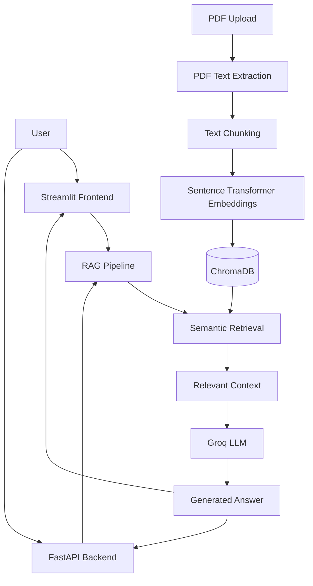

# Engineering Intelligence Hub

An AI-powered Engineering Research Assistant that uses Retrieval-Augmented Generation (RAG) to understand engineering documents and answer questions based on their content.

## Overview

Engineering Intelligence Hub allows users to upload PDF documents and ask questions about their contents. It retrieves relevant information using semantic search and generates context-aware answers using a Large Language Model (LLM).

## Features

- PDF document upload and text extraction
- Automatic text chunking
- Local semantic embeddings
- Persistent vector storage using ChromaDB
- Context-based question answering using RAG
- Source-aware responses with document references
- Multiple PDF document management
- Document deletion
- Streamlit user interface
- FastAPI backend
- Input validation and error handling

## Technology Stack

| Category | Technologies |
|---|---|
| Programming Language | Python |
| Frontend | Streamlit |
| Backend | FastAPI |
| LLM | Groq API |
| Embeddings | Sentence Transformers |
| Vector Database | ChromaDB |
| PDF Processing | PyPDF |
| Text Splitting | LangChain Text Splitters |
| API Testing | Swagger UI |
| Development | VS Code, Git, GitHub |

## System Architecture



## Project Structure

```text
engineering-intelligence-hub/
│
├── data/
│   ├── raw/
│   ├── processed/
│   ├── chroma_db/
│   └── pdf/
│
├── src/
│   ├── embeddings.py
│   ├── generation.py
│   ├── ingestion.py
│   ├── rag_pipeline.py
│   ├── retrieval.py
│   └── vector_store.py
│
├── app.py
├── api.py
├── requirements.txt
├── convert_to_pdf.py
├── .env
└── .gitignore
```

## Installation

### 1. Clone the repository

```bash
git clone https://github.com/yoghalakshme/engineering-intelligence-hub.git
cd engineering-intelligence-hub
```

### 2. Create a virtual environment

```bash
python -m venv venv
```

### 3. Activate the environment

Windows PowerShell:

```powershell
.\venv\Scripts\Activate.ps1
```

### 4. Install dependencies

```bash
pip install -r requirements.txt
```

### 5. Configure environment variables

Create a `.env` file in the project root:

```env
GROQ_API_KEY=your_groq_api_key
```

Never upload your actual API key to GitHub.

## Running the Application

### Start the Streamlit frontend

```bash
streamlit run app.py
```

Open:

http://localhost:8501

### Start the FastAPI backend

Open another terminal and run:

```bash
uvicorn api:app --reload
```

API documentation:

http://127.0.0.1:8000/docs

## API Endpoints

| Method | Endpoint | Description |
|---|---|---|
| GET | `/health` | Check API health |
| POST | `/upload` | Upload a PDF |
| GET | `/documents` | List uploaded documents |
| POST | `/ask` | Ask questions about documents |
| DELETE | `/documents/{filename}` | Delete a document |

## Screenshots

Screenshots of the application will be added here.

## Future Enhancements

- Cloud deployment
- User authentication
- Chat history management
- Retrieval evaluation
- Advanced document processing

## Author

**Engineering Intelligence Hub**

Developed as an AI and Data Science portfolio project.
